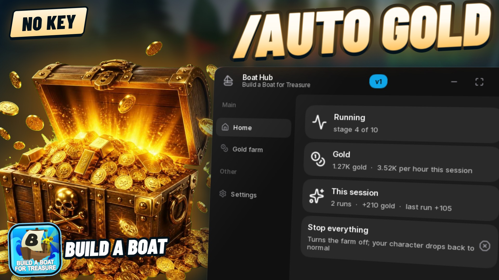

# Boat Hub



An auto gold farm for **Build a Boat for Treasure**. It takes your character down
the river through every stage, opens the golden chest at the end, collects the
gold and goes again. Keyless.

## Run it

```lua
loadstring(game:HttpGet("https://raw.githubusercontent.com/robomohit/BoatHub/main/boathub.lua"))()
```

Paste that into your executor while you're in Build a Boat for Treasure. Open or
hide the window with **Right Ctrl** or the **Boat Hub** button.

## What it does

**Gold farm**
- **Auto farm gold:** flies down the river through all 10 stages, opens the
  golden chest and collects the gold, then starts the next run. A run pays the
  same as sailing it yourself (+105 gold per run on a fresh account in testing,
  about 1 run a minute).
- **Flight speed:** 250 studs/s by default; 150 to 400.
- **Stop after N runs**, or keep going until you stop it.
- **Do one run** and **Claim gold** buttons.

**Other**
- **Anti AFK.**
- A live **Home** page: what it's doing, your gold, gold per hour, and runs this
  session.
- Your settings are saved and come back next time.

## Notes

You don't need a boat: your character makes the trip. Gravity is only switched
off on your own screen during a run and comes back when it ends.

Automating a Roblox game can get the account banned. Use an account you can
afford to lose.

The published script is obfuscated with Prometheus.
Based on Prometheus by Elias Oelschner, https://github.com/prometheus-lua/Prometheus

## Source

Not published. This repository carries the built script only.
